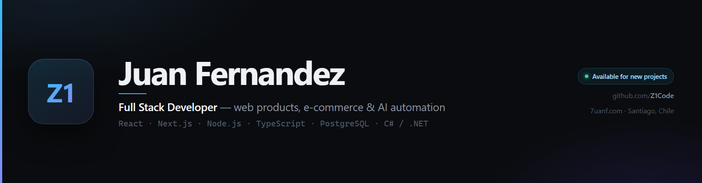

  

  
  

---

I build web products end to end — from the database schema to the pixel that ships.
Most of my work is **Next.js + PostgreSQL**: e-commerce, operations dashboards and
platforms that have to stay up under real traffic. I also write **C# / .NET** for
Windows desktop tooling, and I spend a growing share of my time on **AI automation**
and developer tooling.

📍 Santiago, Chile &nbsp;·&nbsp; 🟢 Available for new projects

## What I work on

### 🌐 Web products & e-commerce
Full storefronts with auth, payments, inventory and admin dashboards.

`Next.js` `TypeScript` `PostgreSQL` `Auth.js`

- **[VelocitySetups](https://velocitysetups.com)** — e-commerce for custom gaming PC builds
- **[IvaniaBeauty](https://ivaniabeauty.com)** — premium shapewear store, shipping Colombia → Chile
- **[GastroCloud](https://github.com/Z1Code/gastrocloud)** — multi-tenant restaurant management SaaS
- **[Garru](https://7uanf.com/garru)** · **[Doblez Empanadas](https://7uanf.com/empanadas)** — brand sites with operations dashboards

### 🧠 AI & automation
Agents, bots and tooling that delete manual steps out of a workflow.

`Python` `Playwright` `Node.js` `LLM APIs`

- **[gcp-oauth-automator](https://github.com/Z1Code/gcp-oauth-automator)** ⭐ — one command, zero manual clicks: provisions Google OAuth clients in GCP via Playwright
- Plus a few private agentic bots I maintain: Telegram → Marketplace publishing, and an AI curation pipeline that scrapes, rewrites and posts repos to X

### 🎨 UI engineering & design systems
- **[glass-refraction](https://github.com/Z1Code/glass-refraction)** ⭐ **38** — Liquid Glass design system: CSS + React components with real SVG refraction, specular highlights and chromatic edge dispersion

### 🖥️ Systems, desktop & infrastructure
`C#` `.NET 8` `Java` `MariaDB`

- **[AirPodsLink](https://github.com/Z1Code/AirPodsLink)** — makes AirPods connect faster on Windows: Bluetooth LE detection plus an A2DP reconnect request, no drivers
- **[Windows-RGB-Hotkeys](https://github.com/Z1Code/Windows-RGB-Hotkeys)** — global hotkeys for OpenRGB devices
- **L2J · Lineage II game servers** — persistent MMORPG worlds: login, gameplay, databases, launchers and production infrastructure

### ❤️ Open source & civic tech
- **[SOS Venezuela 2026](https://sosvenezuela2026.com)** ⭐ **6** — real-time collaborative map after the June 24 M7.5 earthquake. The first web app deployed after the quake: damage reports, missing-person search, shelters and an open API
- **[deepseek-status-bar-for-copilot](https://github.com/Z1Code/deepseek-status-bar-for-copilot)** — VS Code status bar with real DeepSeek cost tracking and a peak/off-peak rate badge with countdown

## Tech I reach for

  
  
  
  
  
  
  
  
  
  
  
  

## Stats

  
  

---

<h3 align="center">Have a project in mind?</h3>

  I'm available for new projects and collaborations. Let's talk.

  
  
  

